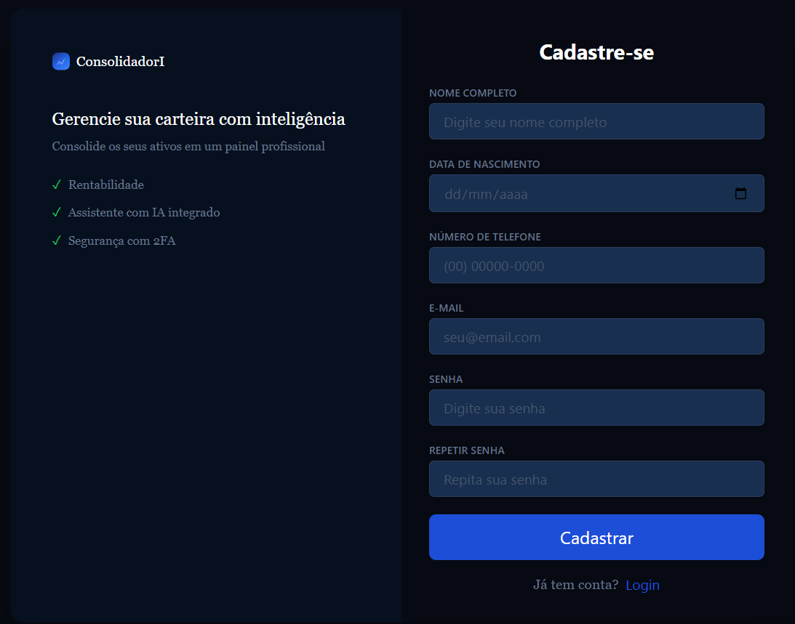

# Consolidador de Carteira de Investimentos - Frontend

### Desenvolvedor:
- Projeto desenvolvido por mim, **Felipe Homem Martins** | [LinkedIn](https://www.linkedin.com/in/felipe-h-martins/) |

### Descrição do Projeto:
- Este projeto consiste em um sistema para centralizar os ativos dos usuários.
- O objetivo é facilitar a visualização dos ativos que o usuário possui em diferentes segmentos: ações, fundos imobiliários e criptomoedas.
- Será permitido cadastrar compras e vendas de ativos, visualizar a porcentagem da carteira em cada segmento, acompanhar o desempenho dos ativos e criar metas para sua carteira.

##

### Screenshots

- Tela de Aprensentação

- Tela de Cadastro

- Tela de Login

